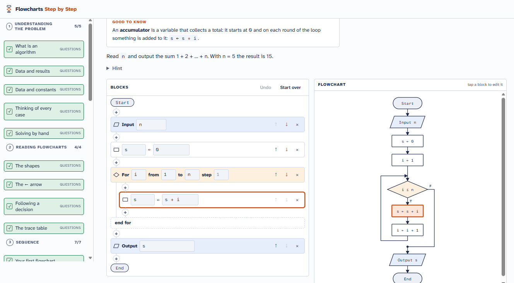

# Flowcharts Step by Step (Diagrammi Passo Passo)

**English** · [Italiano](README.it.md)

Learn to **understand a problem** and **draw its solution** as a flowchart, one step at a time, right in the browser.

Each level asks for one small thing: answer a question about a problem, or build a flowchart with blocks. The flowchart draws itself while you build it, runs with the data you choose, and an automatic check tells you whether it is right, explaining any mistake in plain language. The course is available in English and Italian.

**▶ Try it: [nispa.github.io/learning-diagrams](https://nispa.github.io/learning-diagrams/?locale=en)** — nothing to install, works on phones and offline, can be installed as an app.



Twin project of [C Step by Step](https://github.com/nispa/learning-c): same idea, same architecture, one step before code.

## The course

**43 levels in 7 chapters**, from the basics to working on your own:

| Chapter | What you learn |
| --- | --- |
| 1. Understanding the problem | algorithm, input data, processing, results, constants, edge cases, solving by hand |
| 2. Reading flowcharts | the ISO 5807 shapes, the `←` arrow, following a decision, the trace table |
| 3. Sequence | Input, Output, Assign; finding a bug; swapping variables; first variable table |
| 4. Decisions | If, comparisons, `mod`, nested decisions, `and` / `or` / `not`, special cases |
| 5. Loops | While, For, Repeat; infinite loops; accumulator |
| 6. Common patterns | counter, average, maximum, sentinel, flag, Euclid's algorithm |
| 7. On your own | problems described only in words, with the whole analysis left to the student |

## Features

- **Nothing to install**: it is a static page, everything runs in the browser.
- **Structured block editor**: the flowchart is always well formed, so students focus on the logic rather than on the arrows. Works on phones too.
- **Automatic drawing** with the ISO 5807 symbols (oval, parallelogram, rectangle, diamond); the For loop is drawn as it really works (initialise, check, run, increment). Tapping a shape jumps to its block.
- **Step-by-step execution** with an automatically filled **trace table** and the current block highlighted.
- **Explained errors**: *"You cannot chain two comparisons as in `0 < x < 10`"*, *"The variable `sume` has no value yet… Did you mean `sum`?"*, *"The loop with the condition `i <= 5` … probably never ends"*.
- **Checks that cannot be fooled**: each level tests the flowchart with several inputs, including boundary cases, and can require specific structures (a loop, a single Input, no For…).
- **Checked problem analysis**: in the later levels the student fills in the variable table (name, role, contents) and the check verifies that it matches the flowchart.
- **English and Italian**: interface, messages, block keywords and levels are fully translated. Choose the language in the header (or with `?locale=en`); the choice is saved.
- **Installable app** (PWA) that works offline once opened.
- **Readable and accessible**: Atkinson Hyperlegible font, adjustable text size, light and dark theme, full keyboard use (`Ctrl+Enter` runs).
- **Progress saved** in the browser.

## The block language

| Block | Shape | Example |
| --- | --- | --- |
| Input | parallelogram | `Input n` |
| Output | parallelogram | `Output "Sum:", s` (several values separated by commas) |
| Assign | rectangle | `s ← s + i` |
| If … then … otherwise | diamond | `n mod 2 = 0` |
| While … do | diamond | `i <= n` (checks first) |
| Repeat … while | diamond | `mark < 1 or mark > 10` (checks after) |
| For … from … to … step | diamond | `For i from 1 to n` |

Operators: `+ - * / ^`, `div` (whole-number quotient), `mod` (remainder), `= <> < <= > >=` (also `≠ ≤ ≥`), `and`, `or`, `not`, `true`, `false`. Functions: `abs`, `sqrt`, `int`, `round`. Text in quotes, decimals with a point.

In Italian the blocks are Leggi, Scrivi, Assegna, Se, Mentre, Ripeti, Per and the keywords `e`, `o`, `non`, `vero`, `falso`, `radq`, `intero`, `arrotonda`.

## Getting started

Clone or download the repository and open `index.html` in your browser. That's it.

Fonts come from Google Fonts; without a connection the page still works with system fonts.

To open a specific level: `index.html#cifre`. To choose the language: `index.html?locale=en`.

## Publishing

It is a static site with no build: it is published with **GitHub Pages** straight from the `main` branch (Settings → Pages → Deploy from a branch → `main`, `/`). Every push updates the site. `.nojekyll` tells GitHub to serve the files as they are.

To publish it elsewhere, serve the folder with any static web server.

When served over http/https the page registers `sw.js`: it can be installed as an app and works offline.

## Structure

```
index.html                 the page: markup and <script> tags in the right order, no build
css/app.css                styles
src/i18n/it.js             every text for the student (messages, interface): the reference language
src/i18n/en.js             the same texts in English
src/core/util.js           translation t(), esc(), md(), output comparison, suggestions
src/core/expr.js           expressions: parsing, evaluation, formatting, keywords per language
src/core/flow.js           the flowchart as data (compact array form ↔ objects)
src/core/interpreter.js    runs a flowchart, with limits and trace
src/core/checker.js        checks a level and the variable table
src/core/render.js         draws the flowchart as SVG
src/core/app.js            interface
src/levels/it/levels.js    chapters and levels
src/levels/en/levels.js    the same levels in English (same ids)
sw.js                      service worker: offline use
manifest.webmanifest       the installable app card (icons in icons/)
tests/                     tests (node:test)
```

## Development

You need [Node.js](https://nodejs.org) 20 or newer, only for the tests. No dependencies, no build.

```
npm test
```

The tests check that every level is passed by its solution and not by its starting flowchart, that quiz answers match the execution of the flowchart shown, that every text used exists (and none is unused), that every language has the same keys and levels as Italian, that `index.html` and `sw.js` include every file and that every flowchart can be drawn.

The project rules, for people and agents, are in [AGENTS.md](AGENTS.md) (in Italian); the level format is in [src/levels/README.md](src/levels/README.md).

## Feedback and contributions

Found a mistake, a confusing explanation, or have an idea for a level? Every level has a **"Found a mistake or have an idea?"** link that opens a [GitHub issue](https://github.com/nispa/learning-diagrams/issues/new/choose) with the level already filled in. Teachers who try it with a class are especially welcome: tell us the age and what worked.

The course collects no personal data: progress stays in the browser.

## License

- **Code**: [MIT](LICENSE).
- **Educational content** (levels, texts for students, icons): [CC BY 4.0](LICENSE-CONTENT). You may share and adapt it for any purpose, even commercially, as long as you credit "Diagrammi Passo Passo" by nispa with a link to this repository and say what you changed.
